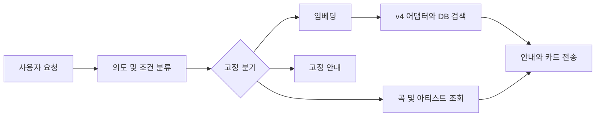
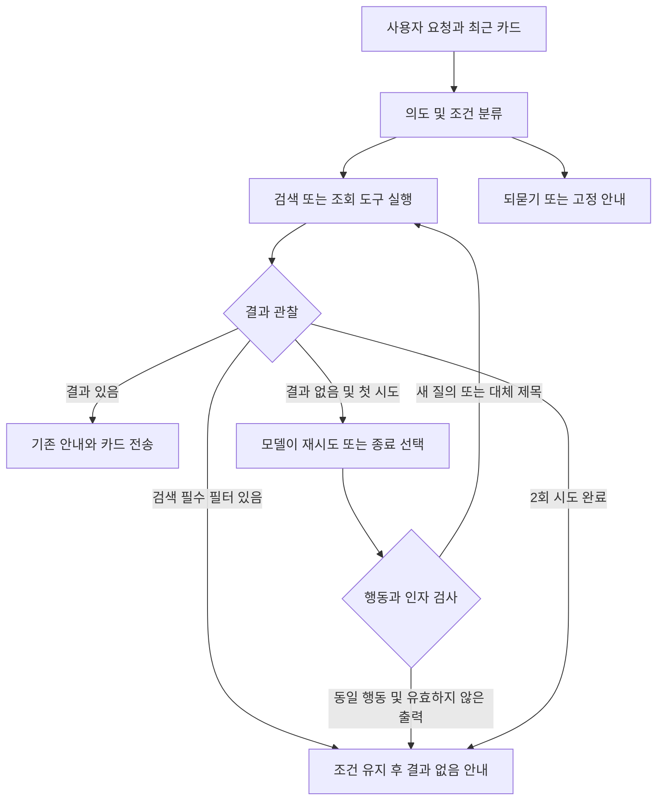
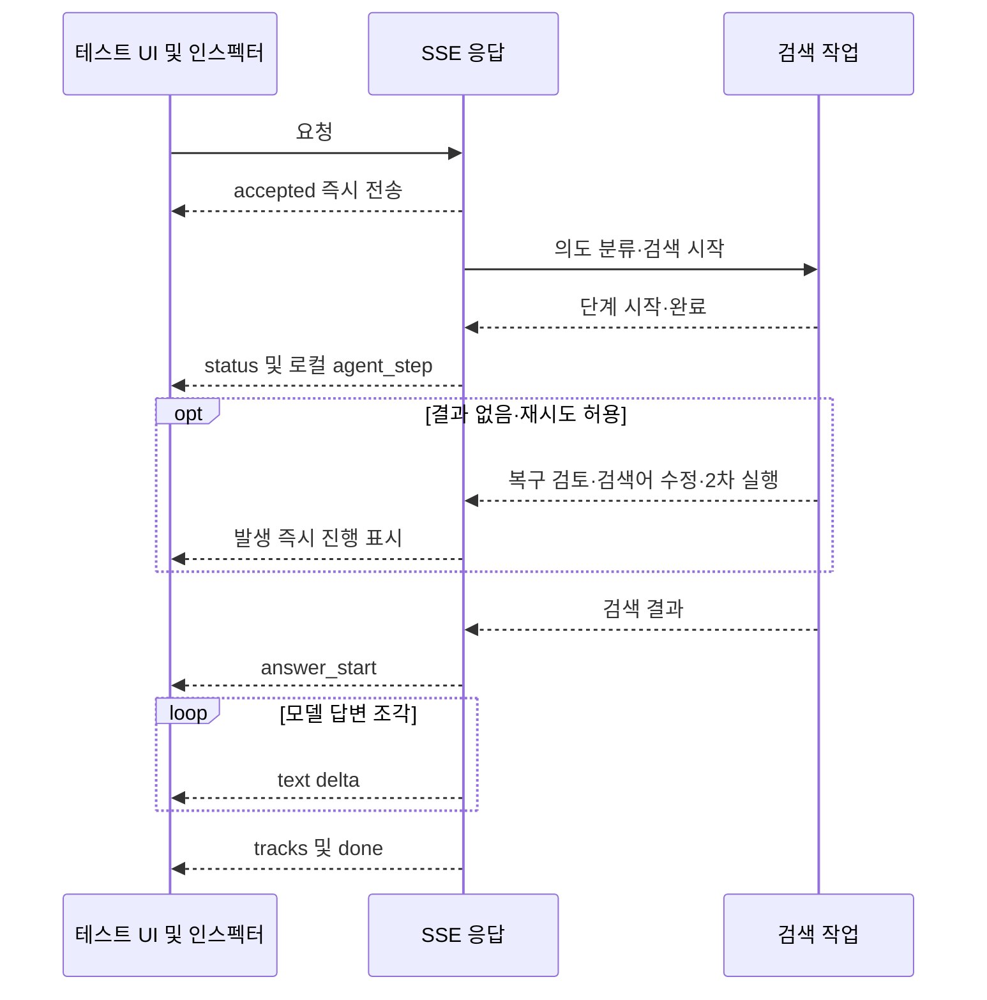

# 에이전틱 챗봇 로컬 실험

브랜치: experiment/agentic-chatbot. 시작점: origin/dev 8157729.

## 실행

```sh
bash run-agentic.sh
```

http://127.0.0.1:8002/app/ 에서 테스트한다. 프로세스에 AGENTIC_CHAT=1,
LOCAL_INSPECTOR=1, SEARCH_EMBEDDING=v4를 적용한다. .env 원본은 변경하지 않는다.
외부 모델 호출에는 기존 API 사용량이 발생한다. 원격 추적은 실험 실행 스크립트에서 끈다.

## 변경 전



## 구현 후



## 적용 개념

1. 제한된 관찰·행동 루프: 결과 없음에서만 복구 모델 호출, 최대 두 도구 단계.
2. 검색 도구 재사용: 임베딩 → 기존 v4 쿼리 어댑터 → emb_v4 검색.
3. 실행 전 검사: 같은 인자 반복 차단, 조회 아티스트 변경 차단, 필터 자동 완화 금지.
4. 인스펙터: 실행 설정, 판단·임베딩·도구 결과·복구·종료 이유와 서버 경과 시간.
5. 대화 상태: 기존 사용자 메시지와 실제 전송 카드 이력 재사용. Jev 경로는 실험에서 비활성화.

## 범위와 한계

- 첫 단계 프로토타입이다. 기존 분류가 초기 도구를 선택하고, 추가 모델은 실패 후 복구 행동을 선택한다.
  공급자 네이티브 tool_calls API를 사용하는 범용 에이전트는 아니다.
- 도구 단계 하나 안에서 기존 조회기의 대체 제목 조회 등이 여러 DB 호출을 수행할 수 있다.
- 45초는 다음 단계 시작을 막는 한도다. 이미 실행 중인 DB·임베딩 호출을 강제 취소하지 않는다.
- 사진과 STT는 기존 경로 유지. 사진 검색에도 실행 환경의 v4 설정을 적용한다.
- 조건 완화 승인·영속 대기 상태·사용자 취소·동일 대화 요청 직렬화는 아직 구현하지 않았다.
- 요청 접수 즉시 SSE를 연다. 단계 시작·결과·복구 결정은 발생 즉시 status와 agent_step으로 전달한다.
  검색 작업은 별도 스레드에서 실행하고, 답변 텍스트는 기존 모델 스트림을 그대로 전달한다.
  UI는 현재 단계·시도 번호·텍스트 조각 수·첫 텍스트 도착 시간·총 시간을 표시한다.
- 상세 진단 정보는 LOCAL_INSPECTOR=1일 때만 노출한다. 실행 스크립트는 루프백 주소에 바인딩한다.
- 모델이 재작성한 자유 텍스트의 의미 동등성은 보장하지 못한다. 품질 비교가 필요하다.

## 로컬 확인

- `퇴근길에 들을 잔잔한 음악 두 곡 추천해줘`: v4 검색, 결과가 있으면 한 번으로 종료.
- `음악 추천해줘`: 정보 부족 안내, 검색 미실행.
- 존재하지 않는 곡 제목 조회: 복구 선택과 중복 차단·시도 한도 확인.

자동 테스트는 모델 없이 실행한다. 실제 모델·DB 연결 성공과 구분한다.

## 최초 구현 검증 결과

- 관련 자동 테스트 58개 통과. UI JavaScript 구문 검사 및 git diff --check 통과.
- /health, /readiness, /local/experiment, /app/ HTTP 200.
- DB: 전체 19,218곡 중 v4 벡터 19,010개 확인.
- 실제 텍스트 추천 1건: HTTP 200, v4 검색 2곡, agent_trace·tracks·done 수신.
  이번 요청의 서버 검색 완료는 약 24.6초. 반복 측정한 성능 수치가 아니다.
- 복구 분기는 모의 모델로 검증했으며 실제 공급자 복구 판단의 품질은 미평가.
- 앱 브라우저 자동 조작이 비활성화되어 시각·클릭 검증은 수행하지 못했다.

## 실시간 진행 표시 개선



- 기존 문제: prepare_recommendation이 끝나야 HTTP 응답이 열렸고 agent_trace는 사후 일괄 전달이었다.
- 현재 구조: 요청별 이벤트 큐로 검색 실행과 SSE 전송을 분리한다. 최대 2회 도구 실행이라 진행 이벤트 수는 제한된다.
- 연결 종료 시 다음 단계 이벤트에서 작업을 중단한다. 이미 실행 중인 외부 모델·DB 호출을 강제 취소하지는 못한다.
- SSE가 열린 뒤 검색 오류는 HTTP 503 대신 error 이벤트로 전달한다. 성공 done을 보내지 않는다.
  일반 비실험 경로의 기존 HTTP 오류 처리는 유지한다.
- 테스트 63개 통과: 검색 종료 전 이벤트 수신, 답변 완료 전 텍스트 조각 수신, 재시도 순서,
  연결 종료 후 다음 단계 중단, 상세 진단 비공개 설정, 오류 전송 및 기존 채팅 동작 포함.
- JavaScript 구문 검사와 git diff --check 통과. 브라우저 시각·클릭 검증은 별도 필요하다.
- 실제 v4 추천 1건의 HTTP 스트림 검증: 접수 0.07초, 의도 분석 시작 0.09초,
  분류 완료 4.93초, 임베딩 완료·검색 시작 6.77초, 검색 완료 14.26초,
  첫 텍스트 15.14초, 완료 15.45초. 텍스트 조각 20개, 추천곡 2개 수신.
  단일 요청 관측값이며 성능 평균이나 개선율을 뜻하지 않는다.

## 서비스 스타일의 로컬 UI

- 서비스 FE 디자인 스냅샷 4975ec3의 색상·SUIT 글꼴·아이콘·말풍선·곡 카드·입력창을 이식했다.
  FE 저장소의 자동 동기화는 없으며 React 의존성 없이 기존 실행 명령을 유지한다.
- 채팅 내 진행 패널은 실제 SSE 단계·결과·복구 결정을 표시하고 완료 후 접힌다.
- 인스펙터는 실행 요약 / 이벤트 / 요청·응답 탭으로 나눈다. 원문 복사, 입력만 채우는 예시,
  status/agent_step 중복 표시 병합, 첫 이벤트·첫 텍스트·전체 시간과 텍스트 조각 수를 제공한다.
- 모바일에서는 상단 버튼으로 인스펙터를 연다. FE 디자인 출처·범위는 backend/static/DESIGN-SNAPSHOT.md에 기록했다.
