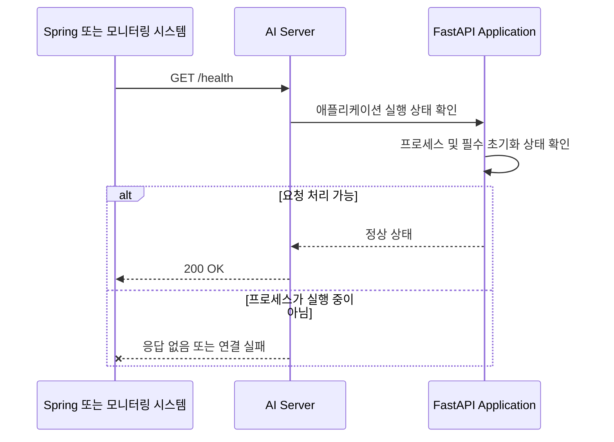
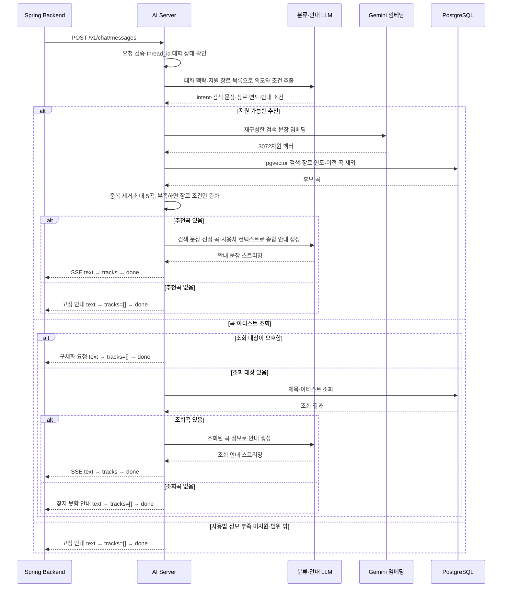
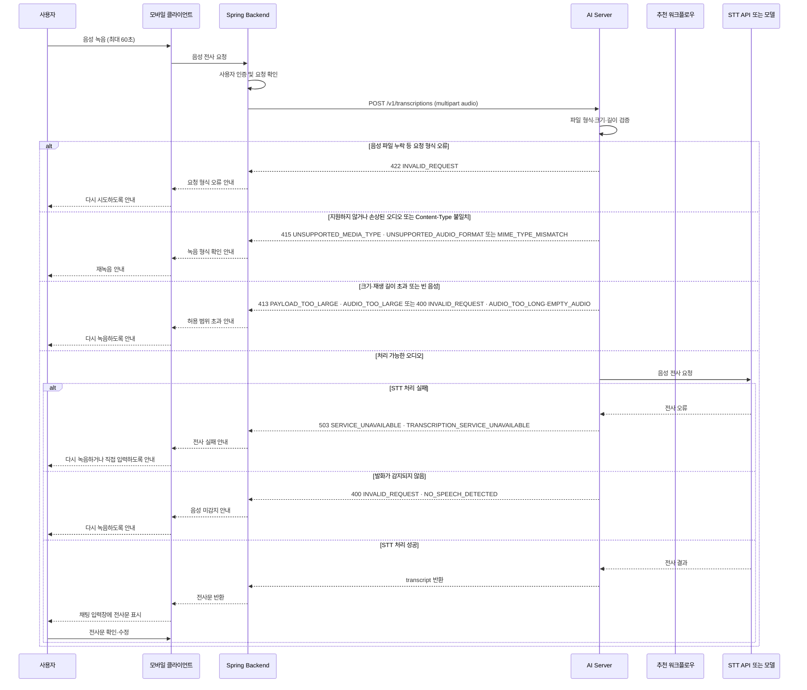
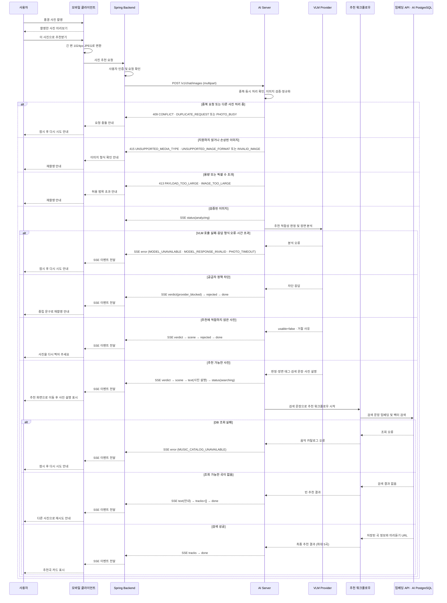
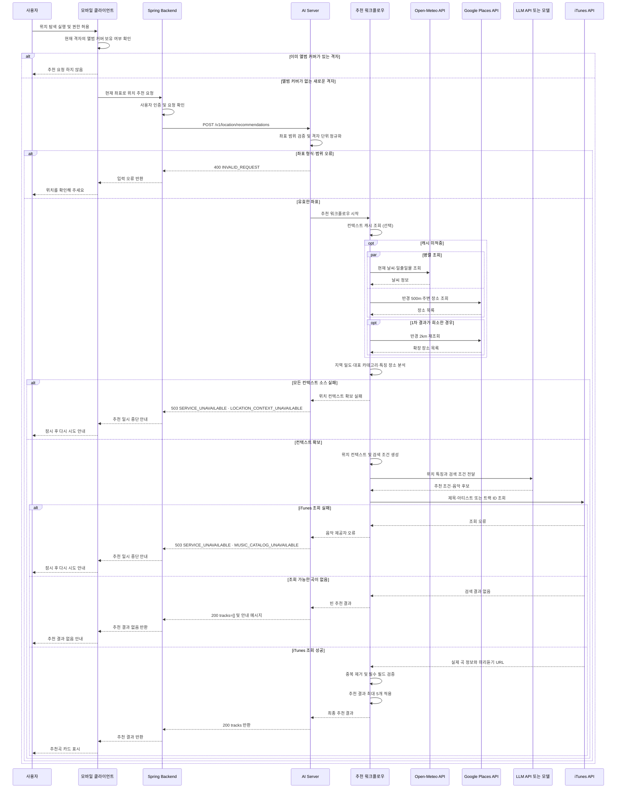

# 모델 API 설계

> [모델 API 설계 시트](https://docs.google.com/spreadsheets/d/1NRPGWvaZ_pHjUXt748-iBMnRgkhdlUHfoJDnX1DPWz0/edit?gid=1878554884#gid=1878554884)

이 문서는 Spring Backend와 AI Server 사이의 API 계약을 정의한다. 풀스택은 아래 요청·응답·이벤트 계약을 기준으로 V1·V2 기능을 연동한다. 구현과 협업 시에는 엔드포인트, 필수·선택 필드, 검증 규칙, 성공·오류 응답을 먼저 확인한다.

> API 계약은 코드와 OpenAPI를 최종 기준으로 관리한다. 계약이 변경되면 팀원과 함께 위키 페이지를 갱신한다.

## 기능별 처리 흐름 프리뷰

<details>
<summary><strong>1. AI 서버 상태 확인 — 시퀀스 다이어그램과 설계 이유</strong></summary>

### AI 서버 상태 확인

Spring 서버, 컨테이너 플랫폼 또는 모니터링 시스템이 AI 서버의 기본 실행 상태를 확인한다. 헬스체크에서는 비용과 지연이 발생하는 LLM, STT, VLM, 임베딩 API와 DB를 호출하지 않는다.



### 설계 이유

- AI 서버가 HTTP 요청을 받을 수 있는지 빠르게 확인한다.
- 반복되는 헬스체크에서 외부 유료 API를 호출하지 않는다.
- 외부 AI 모델이나 DB의 일시적인 장애를 AI 서버 프로세스 장애와 구분한다.
- 컨테이너 재시작과 배포 상태 판단에 사용할 수 있도록 응답을 단순하게 유지한다.
- 외부 의존성 점검은 `/health`에 포함하지 않고 별도의 `GET /readiness`로 분리했다. readiness는 DB 연결과 추천 가능 곡 존재 여부를 확인한다.

</details>

<details>
<summary><strong>2. 텍스트 음악 추천 — 시퀀스 다이어그램과 설계 이유</strong></summary>

### 텍스트 음악 추천

사용자 메시지와 같은 채팅의 대화 맥락을 바탕으로 검색 조건을 추출한다. 곡은 PostgreSQL 카탈로그에서 선정하며, 종합 안내는 검색 이후 별도 LLM으로 생성한다. 곡별 이유 생성 호출은 제거했다.



### 설계 이유

- 사용자가 전송을 확정한 메시지만 추천에 사용한다.
- 모델이 곡을 생성하지 않는다. iTunes에서 수집해 AI DB에 저장한 곡 중에서 벡터 검색으로 고른다.
- 사용자 메시지는 LLM이 한국어 검색 문장으로 재구성하고, Gemini 임베딩으로 검색한다. 장르·연도 필터로 결과가 부족하면 장르 조건 없이 다시 검색한다.
- 같은 프로세스의 `thread_id`별 최근 추천 ID 100개를 검색에서 제외한다. 검색 직후 기록하므로 응답 전송 실패 시에도 제외될 수 있으며, 재시작·다중 워커에서는 기록을 공유하지 않는다.
- 특정 곡·아티스트를 묻는 요청은 AI DB에서 제목·아티스트로 조회해 같은 SSE 형식으로 응답한다.
- 음악 제목, 아티스트, 앨범 이미지와 미리듣기 URL을 정규화하여 반환한다.
- 챗봇 안내 문장은 `text` 이벤트로 스트리밍하고, 추천곡 카드는 검증이 끝난 배열을 `tracks` 이벤트로 한 번만 반환한다.
- 검색 결과가 없는 경우는 장애가 아니므로 `200`과 빈 목록, 안내 메시지로 처리한다.
- 일반 추천 성공 경로는 생성 LLM 2회(의도 분류·종합 안내)와 임베딩 1회를 사용한다. 빈 결과·고정 안내 분기는 종합 안내 LLM을 호출하지 않는다.
- `tracks[].reason`은 추천·조회 응답에서 제거했다. 요청 형식과 `text` → `tracks` → `done` 순서는 유지한다.
- 곡 조회는 원래 곡별 이유 생성 호출이 없었으며, 결과가 있으면 기존 조회 안내 LLM을 사용한다.
- SSE 시작 전 오류는 HTTP 오류 응답, 스트리밍 중 오류는 `error` 이벤트로 반환하며 정상 종료로 처리하지 않는다.

</details>

<details>
<summary><strong>3. 음성 전사 — 시퀀스 다이어그램과 설계 이유</strong></summary>

### 음성 전사

음성을 텍스트 초안으로 변환하여 채팅 입력창에 표시한다. 사용자가 전사문을 확인·수정한 뒤 전송하면 기존 텍스트 음악 추천 API를 실행한다.



### 설계 이유

- 음성 인식 결과를 바로 추천에 사용하지 않고 채팅 입력창에 초안으로 표시한다.
- 사용자가 잘못 인식된 내용을 수정한 뒤 전송할 수 있게 한다.
- 확정된 전사문은 별도 음성 추천 API가 아니라 `/v1/chat/messages`로 전달한다.
- 사용자가 확정한 전사문은 텍스트 입력과 동일한 추천 워크플로우와 응답 형식을 사용한다.
- 오디오 검증, 음성 전사, 음악 추천의 실패 지점을 구분한다.

</details>

<details>
<summary><strong>4. 사진 음악 추천 — 시퀀스 다이어그램과 설계 이유</strong></summary>

### 사진 음악 추천

사용자가 촬영한 풍경 사진을 검증하고, VLM으로 추천 적합성과 풍경 특징을 분석한다. 추천 가능한 사진이면 VLM이 만든 한국어 검색 문장으로 텍스트 추천과 같은 임베딩·DB 검색을 실행한다.



### 내부 처리 순서

```text
요청 중복·동시 처리 확인
→ 이미지 검증 및 정규화 (EXIF 회전 · 메타데이터 제거 · 긴 변 1024px)
→ VLM 추천 적합성 판정, 장면 분석, 한국어 검색 문장·사진 설명 생성
→ 판정과 사진 설명 먼저 전송
→ 검색 문장 임베딩 및 AI DB 벡터 검색
→ 추천곡 전송
```

### 설계 이유

- 파일 형식, 크기와 손상 여부는 VLM 호출 전에 검사하여 불필요한 모델 비용을 줄인다.
- 사진 적합성 판정, 장면 분석, 검색 문장과 사진 설명을 한 번의 VLM 호출에서 JSON 스키마로 받는다.
- 추천에 적합하지 않은 사진은 음악 검색과 추가 모델 호출을 실행하지 않는다.
- 판정과 사진 설명을 곡 검색 전에 먼저 보내 FE가 화면 이동을 바로 결정하게 한다. 사진 설명은 곡이 정해지기 전 문장이므로 특정 곡을 언급하지 않는다.
- 모델이 곡을 생성하지 않고, 텍스트 추천과 같은 AI DB 벡터 검색으로 실제 곡을 고른다.
- 사진은 Base64 대신 multipart로 받는다. Base64 인코딩의 약 33% 크기 증가를 피하고 음성 전사와 같은 업로드 방식을 쓴다.
- 사진 속 글자는 보조 맥락으로만 쓰고 지시로 따르지 않도록 프롬프트에 명시한다. 완전한 차단을 보장하지는 않는다.

### 모델 호출 횟수

| 경로 | 호출 순서 | 일반 성공 시 호출 수 |
|---|---|---|
| 사진 추천 | VLM 분석·검색 문장·사진 설명 → 임베딩 | 2회 |

곡별 이유 생성 호출은 제거했다. 부적합 사진은 임베딩·검색을 실행하지 않는다. 검색 결과가 없으면 고정 안내와 빈 곡 목록을 반환한다. 선택적 VLM 폴백이 실행되면 호출이 1회 추가된다. 사진 설명은 VLM이 생성하므로 별도의 최종 답변 LLM은 호출하지 않는다.

</details>

<details>
<summary><strong>5. 위치 음악 추천 — 시퀀스 다이어그램과 설계 이유</strong></summary>

### 위치 음악 추천

> 제품 V3에서 적용할 기능이다. `/v1`은 제품 버전이 아니라 API 계약 버전을 의미하므로 첫 번째 위치 추천 API는 `/v1/location/recommendations`로 정의한다.

사용자의 현재 위치를 격자 단위로 변환하고, 날씨와 주변 장소 정보를 조합하여 해당 공간에 어울리는 음악을 추천한다. 이미 추천 결과가 등록된 격자는 기존 결과를 재사용한다.

### 위치 추천 흐름



### 내부 처리 순서

```text
좌표 검증
→ 격자 단위 정규화
→ 컨텍스트 캐시 조회
→ 날씨·주변 장소 조회
→ 위치 특징 및 음악 검색 조건 생성
→ iTunes 음악 검색
→ 추천 이유 생성
→ 응답 검증 및 정제
```

### 설계 이유

- 격자 판정과 10분 주기 위치 확인은 클라이언트에서 수행하고, AI 서버는 추천이 필요하다고 판단된 좌표만 처리한다.
- 주변 장소는 좁은 반경을 먼저 조회하고 결과가 희소한 경우에만 반경을 확장하여 외부 API 호출 횟수를 제한한다.
- 날씨와 장소 정보는 서로 의존하지 않으므로 병렬로 조회하여 응답 지연을 줄인다.
- 한쪽 컨텍스트만 확보해도 추천을 계속하고, 모든 컨텍스트를 확보하지 못한 경우에만 실패로 처리한다.
- 모델이 생성한 곡을 그대로 반환하지 않고 iTunes에서 실제 곡 정보를 확인한다.

### 위치 정보 처리 원칙

- 사용자가 위치 탐색을 시작하고 권한을 허용한 경우에만 현재 좌표를 수집하며 백그라운드 수집은 하지 않는다.
- 정확한 좌표는 날씨와 장소 조회에만 사용하고 추천 생성 모델에는 전달하지 않는다.
- 추천 생성 모델에는 날씨, 시간대, 지역 밀도와 대표 장소 유형처럼 정규화된 특징만 전달한다.
- AI 서버는 좌표를 저장하지 않고 요청을 처리하는 동안에만 사용하며, 로그에는 격자 단위로 낮춘 값만 남긴다.
- 사용자별 격자 추천 결과는 Spring이 격자 단위로 저장하며, 정확한 좌표는 기록에 포함하지 않는다.

</details>

---


## API 계약 한눈에 보기

| 제품 범위 | API | 역할 | 필수 요청값 | 선택 요청값 | 성공 응답 |
|---|---|---|---|---|---|
| V1~V3 | `GET /health` | AI 서버 실행 상태 확인 | 없음 | 없음 | `status` |
| V1~V3 | `GET /readiness` | DB 연결과 추천 가능 곡 확인 | 없음 | 없음 | `status` (`200` 또는 `503`) |
| V1 | `POST /v1/chat/messages` | 확정 텍스트 기반 음악 추천 | `thread_id`<br>`request_id`<br>`message` | `user_context` | SSE `text`<br>`tracks`<br>`done` 또는 `error` |
| V1 | `POST /v1/transcriptions` | 음성을 수정 가능한 텍스트 초안으로 변환 | `audio` (multipart 파일) | 없음 | `transcript` |
| V2 | `POST /v1/chat/images` | 풍경 사진 기반 음악 추천 | `image` (multipart JPEG)<br>`thread_id`<br>`request_id` | 없음 | SSE `status`·`verdict`·`scene`<br>적합: `text`·`tracks`·`done`<br>거절: `rejected`·`done`<br>오류: `error` |
| V3 | `POST /v1/location/recommendations` | 위치·날씨·주변 장소 기반 음악 추천 | `latitude`<br>`longitude` | `user_context` | `message`<br>`tracks` |

`V1~V3`은 서비스 기능의 출시 범위이고, 엔드포인트의 `/v1`은 API 계약 버전이다. 따라서 제품 V2와 V3에서 기능이 추가되더라도 각 기능의 첫 번째 API 명세는 `/v1`으로 시작한다.

음성 입력은 음성 자체로 음악을 추천하는 기능이 아니다. STT 결과를 채팅 입력창에 표시한 뒤 사용자가 수정·확정하면 텍스트 음악 추천 API를 호출한다.

사진과 위치 입력은 사용자 확인 이후 각각의 추천 API를 호출한다. 실제 음악 정보 조회와 최종 응답 정제는 텍스트 추천과 동일한 공통 추천 모듈을 사용한다.


---


## 핵심 API 설계

### 공통 설계 원칙

| 구분 | 설계 원칙 |
|---|---|
| 호출 방향 | 모바일 클라이언트는 AI Server를 직접 호출하지 않으며, 모든 요청은 `Client → Spring Backend → AI Server` 순서로 전달한다. |
| 인증·인가 | 사용자 인증과 서비스 접근 권한 검사는 Spring Backend가 담당한다. AI Server는 전달받은 입력의 형식과 처리 가능 여부를 검증한다. |
| AI Server 책임 | 입력 검증, 모델 호출, 음악 검색, 응답 검증과 정제를 담당한다. |
| 대화 맥락 | 텍스트와 사진 추천은 `thread_id`로 현재 채팅 맥락을 구분한다. 음성 전사와 위치 추천은 대화 맥락을 사용하지 않는다. |
| 중복 처리 | 텍스트와 사진 추천은 요청마다 `request_id`를 발급한다. 사진 추천은 AI Server가 같은 `(thread_id, request_id)`의 중복 요청을 프로세스당 최근 256건·최대 10분 범위에서 `409`로 막는다. 텍스트 추천의 중복 처리는 Spring Backend와 AI Server의 책임 범위 확정 전이라 아직 구현하지 않았다. |
| 사용자 확정 | 음성 전사 결과는 추천 입력이 아닌 수정 가능한 초안이다. 사용자가 확인·수정한 뒤 `/v1/chat/messages`로 전송해야 추천을 실행한다. |
| 외부 결과 검증 | 모델은 곡을 생성하지 않는다. 추천곡은 iTunes에서 수집해 AI DB에 저장한 곡 중에서만 벡터 검색으로 고르고, 모델의 구조화 응답은 JSON 스키마로 검증한다. |
| 실패 처리 | 입력 오류, 미디어 오류, 모델 장애, 음악 카탈로그 장애를 구분한다. SSE 시작 전 오류는 HTTP 오류 응답으로, 시작 후 오류는 `error` 이벤트로 반환한다. 추천 결과가 없는 경우는 `tracks: []` 이벤트로 반환한다. 요청값 검증 실패는 현재 텍스트 추천이 `400`, 음성 전사와 사진 추천이 `422`를 반환한다. |
| 응답 계약 | V1 텍스트 추천은 안내 문장을 `text` 이벤트로 스트리밍하고, 완성된 추천곡 배열을 `tracks` 이벤트로 한 번 반환한다. 사진 추천은 판정(`verdict`)을 먼저 보내는 SSE를 사용한다. 음성 전사는 수정 가능한 `transcript` 초안을 반환한다. |
| 버전 | 제품 범위 V1·V2·V3와 API 계약 버전 `/v1`은 서로 다른 개념이다. 새 제품 기능의 첫 계약도 `/v1`에서 시작할 수 있다. |

## 공통 데이터 계약

### 표기 규칙

| 표기 | 의미 |
|---|---|
| 필수 | 요청에는 반드시 포함하고, 성공 응답에는 항상 반환한다. |
| 선택 | 요청에서 생략할 수 있다. 값이 제공되면 각 필드의 타입과 제약을 지켜야 한다. |
| nullable | 응답 필드는 항상 반환하지만, 값이 없을 때는 `null`을 반환할 수 있다. |

### `user_context` 요청 객체

`user_context`는 추천 품질을 보조하는 선택 객체다. 객체 전체와 내부 필드를 모두 생략할 수 있다. 현재 명세에 정의되지 않은 값의 범위와 열거형은 OpenAPI 확정 전까지 임의로 가정하지 않는다.

| 필드 | 타입 | 필수 여부 | 처리 원칙 |
|---|---|---|---|
| `age` | integer | 선택 | 현재는 종합 안내 문장 생성에만 참고한다. 검색·필터·정렬에는 적용하지 않는다. |
| `gender` | string | 선택 | 현재는 종합 안내 문장 생성에만 참고한다. |
| `preferred_genres` | array&lt;string&gt; | 선택 | 선호 장르 목록. 현재는 종합 안내 문장 생성에만 참고하며 검색·필터·정렬에는 적용하지 않는다. |

### 음악 추천 SSE 응답

V1 텍스트 추천은 `200 OK` 연결을 유지하면서 다음 이벤트를 순서대로 반환한다. `text`는 여러 번 올 수 있고, `tracks`와 `done`은 정상 응답에서 한 번만 온다.

| 이벤트 | `data` 필드 | 설명 |
|---|---|---|
| `text` | `delta: string` | 화면에 이어 붙일 추천 안내 문장 조각 |
| `tracks` | `tracks: array<track>` | 검증과 정제가 끝난 추천곡 전체 목록. 최소 0개, 최대 5개 |
| `done` | 빈 객체 | 정상 스트림 종료 |
| `error` | `detail: string` | 스트리밍 시작 후 발생한 오류 |

#### `track` 객체

추천·조회 응답에서 곡별 `reason` 필드를 제거했다. BE·FE는 해당 필드를 필수로 파싱하거나 표시하지 않아야 한다. 오류 응답의 `details.reason`과 사진 판정의 거절 사유는 별도 필드이며 제거 대상이 아니다. 텍스트·사진 추천과 곡 조회 모두 공통 곡 응답에서 `reason`을 제거했다. 사진은 VLM 설명을 유지하며 검색 후 별도 생성 LLM을 호출하지 않는다.

| 필드 | 타입 | 필수 여부 | 설명 |
|---|---|---|---|
| `title` | string | 필수 | iTunes에서 수집해 AI DB에 저장한 곡 제목 원문 |
| `artist` | string | 필수 | iTunes에서 수집한 아티스트명 원문. 단일 문자열 |
| `track_id` | string | 필수 | iTunes 트랙 ID를 숫자 문자열로 반환 |
| `preview_url` | string 또는 null | 필수 | 미리듣기 URL. 제공되지 않으면 `null` |
| `artwork_url` | string 또는 null | 필수 | HTTPS 앨범 이미지 URL. 제공 시 600×600 규격 사용 |
| `store_url` | string 또는 null | 필수 | 곡 상세 페이지 URL. 추천 결과는 값이 있으며 조회 결과는 `null`일 수 있음 |

```text
event: text
data: {"delta":"현재 분위기에 "}

event: text
data: {"delta":"어울리는 곡을 골라봤어요."}

event: tracks
data: {"tracks":[{"title":"노을","artist":"카더가든","track_id":"1234567890","preview_url":"https://audio-ssl.itunes.apple.com/itunes-assets/AudioPreview/example1.m4a","artwork_url":"https://is1-ssl.mzstatic.com/image/thumb/Music/example1/600x600bb.jpg","store_url":"https://music.apple.com/kr/album/example1?i=1234567890"}]}

event: done
data: {}
```

추천 가능한 곡이 없으면 오류 대신 안내 문장과 빈 추천곡 배열을 반환한다.

```text
event: text
data: {"delta":"조건에 맞는 곡을 찾지 못했어요. 다른 분위기로 다시 요청해 주세요."}

event: tracks
data: {"tracks":[]}

event: done
data: {}
```

### 공통 오류 응답

| 필드 | 타입 | 필수 여부 | 설명 |
|---|---|---|---|
| `code` | string | 필수 | 클라이언트 분기용 상위 오류 코드 |
| `message` | string | 필수 | 사용자에게 전달할 수 있는 오류 안내 문구 |
| `details` | object 또는 null | 필수 | 세부 원인과 제한값. 추가 정보가 없으면 `null` |
| `details.reason` | string | 조건부 필수 | 하나의 상태 코드 안에서 실패 원인을 구분할 때 사용 |
| `details.max_decoded_bytes` | integer | 조건부 필수 | 디코딩된 파일 크기 제한을 초과했을 때 허용 최대 바이트 수. 현재 구현은 반환하지 않는다 |

```json
{
  "code": "SERVICE_UNAVAILABLE",
  "message": "일시적으로 AI 기능을 사용할 수 없습니다.",
  "details": {
    "reason": "MODEL_UNAVAILABLE"
  }
}
```

---

## API별 요청·응답 계약

### 1. AI 서버 상태 확인

`GET /health`

Spring Backend, 배포 플랫폼 또는 모니터링 시스템이 FastAPI 프로세스가 HTTP 요청에 응답하는지 확인한다. 반복 호출에 비용과 지연이 생기지 않도록 LLM, STT, VLM, 임베딩 API와 DB는 호출하지 않는다. DB 연결과 추천 가능 곡 존재 여부는 별도의 `GET /readiness`로 확인한다.

#### 요청

요청 본문과 필수 파라미터가 없다.

#### 응답

| HTTP | 응답 | 의미 |
|---|---|---|
| `200` | `{ "status": "ok" }` | HTTP 요청을 처리할 수 있음 |

`200 OK` 응답 필드는 다음과 같다.

| 필드 | 타입 | 필수 여부 | 설명 |
|---|---|---|---|
| `status` | string | 필수 | 정상 상태에서는 `ok` |

프로세스가 실행 중이 아니면 HTTP 응답 없이 연결이 실패한다. `/health`는 `503`을 반환하지 않는다.

`GET /readiness`는 DB 연결과 추천 가능 곡이 있으면 `200`, 아니면 `503`을 반환한다. 응답 본문은 `status` 필드 하나다.

### 2. 텍스트 음악 추천

`POST /v1/chat/messages`

사용자가 전송을 확정한 텍스트와 현재 채팅 맥락을 처리하여 실제 조회 가능한 음악을 최대 5곡 추천한다. 직접 입력한 텍스트와 사용자가 확인·수정한 STT 전사문은 모두 같은 `message`로 처리한다.

#### 요청 필드

| 필드 | 타입·제약 | 필수 여부 | 처리 방식 |
|---|---|---|---|
| `thread_id` | string(UUID) | 필수 | 채팅방 진입 시 한 번 발급하고 같은 채팅 세션 동안 유지한다. |
| `request_id` | string(UUID) | 필수 | 사용자 요청마다 새로 발급하는 요청 식별자다. 현재 AI Server는 텍스트 추천의 중복 요청을 차단하지 않는다. |
| `message` | string, 1~200자 | 필수 | 사용자가 전송을 확정한 추천 요청 문장 |
| `user_context` | object | 선택 | 나이·성별·선호 장르를 포함하는 개인화 보조 정보 |

#### 성공 응답

`200 OK`와 `text/event-stream`으로 응답한다. 안내 문장은 `text` 이벤트로 스트리밍하고, 검증이 끝난 전체 추천곡은 `tracks` 이벤트로 한 번 반환한 뒤 `done`으로 종료한다.

#### 오류 응답

| HTTP | `code` | `details.reason` | 발생 조건 |
|---|---|---|---|
| `400` | `INVALID_REQUEST` | 없음 | UUID 형식, 메시지 길이 등 요청값이 계약에 맞지 않음 |
| `503` | `SERVICE_UNAVAILABLE` | `MODEL_UNAVAILABLE` | 모델 제공자를 호출할 수 없음 |
| `503` | `SERVICE_UNAVAILABLE` | `MUSIC_CATALOG_UNAVAILABLE` | AI DB 음악 검색을 사용할 수 없음 |

SSE 응답을 시작하기 전에 발생한 오류는 위 HTTP 오류 응답을 사용한다. `text` 이벤트를 전송한 뒤 발생한 오류는 HTTP 상태를 변경할 수 없으므로 `error` 이벤트를 보내고 스트림을 종료한다.

### 3. 음성 전사

`POST /v1/transcriptions`

음성 파일을 수정 가능한 텍스트 초안으로 변환한다. 이 API는 음악 추천, 채팅 메시지 전송, 대화 저장을 수행하지 않는다.

#### 요청 필드

`multipart/form-data`로 전송한다.

| 필드 | 타입·제약 | 필수 여부 | 처리 방식 |
|---|---|---|---|
| `audio` | file | 필수 | FE가 최대 60초 녹음한 음성 파일. 파일의 `Content-Type`은 실제 형식과 일치해야 한다. 지원 형식은 WAV, WebM, MP4(M4A), Ogg, MP3, FLAC이다. |

#### 서버 검증

| 검증 항목 | 허용 기준 | 실패 응답 |
|---|---|---|
| 요청 형식 | multipart `audio` 필드 포함 | `422 INVALID_REQUEST` |
| 파일 크기 | 10 MiB 이하 | `413 AUDIO_TOO_LARGE` |
| 빈 파일 | 녹음된 내용이 있음 | `400 EMPTY_AUDIO` |
| 파일 형식 | 지원 형식이며 파일 시그니처와 `Content-Type` 일치 | `415 UNSUPPORTED_AUDIO_FORMAT` 또는 `415 MIME_TYPE_MISMATCH` |
| 디코딩 | FFmpeg로 손상 없이 디코딩 가능 | `415 UNSUPPORTED_AUDIO_FORMAT` |
| 재생 길이 | 60초 이하 | `400 AUDIO_TOO_LONG` |
| 발화 | 음성이 감지됨 | `400 NO_SPEECH_DETECTED` |

#### 성공 응답

| 필드 | 타입 | 필수 여부 | 설명 |
|---|---|---|---|
| `transcript` | string | 필수 | 사용자가 수정한 뒤 텍스트 추천 요청으로 전송할 수 있는 전사 초안 |

#### 오류 응답

| HTTP | `code` | `details.reason` |
|---|---|---|
| `400` | `INVALID_REQUEST` | `EMPTY_AUDIO`, `AUDIO_TOO_LONG`, `NO_SPEECH_DETECTED` |
| `413` | `PAYLOAD_TOO_LARGE` | `AUDIO_TOO_LARGE` |
| `415` | `UNSUPPORTED_MEDIA_TYPE` | `MIME_TYPE_MISMATCH`, `UNSUPPORTED_AUDIO_FORMAT` |
| `422` | `INVALID_REQUEST` | 없음(`details: null`). `audio` 누락 등 요청값 검증 실패 |
| `503` | `SERVICE_UNAVAILABLE` | `TRANSCRIPTION_SERVICE_UNAVAILABLE` |

### 4. 사진 음악 추천

`POST /v1/chat/images` · 제품 V2

사용자가 촬영한 사진 1장을 VLM으로 분석해 추천 가능 여부를 판정하고, 추천 가능하면 VLM이 만든 한국어 검색 문장으로 텍스트 추천과 같은 임베딩·DB 검색을 실행한다. 질문 입력과 텍스트 전사 단계는 없다.

#### 요청 필드

`multipart/form-data`로 전송한다.

| 필드 | 타입·제약 | 필수 여부 | 처리 방식 |
|---|---|---|---|
| `image` | file, JPEG | 필수 | 촬영한 사진 1장 |
| `thread_id` | string(UUID) | 필수 | 현재 채팅 세션 식별자. 사진 분석 결과를 이후 대화 맥락에 남긴다. |
| `request_id` | string(UUID) | 필수 | 요청별 중복 처리 방지 식별자 |

`user_context`는 요청 필드로 정의하지 않는다. 사진 경로에는 이를 사용할 최종 답변 생성 단계가 없다.

#### 요청 예시

```bash
curl -N -X POST "$AI_BASE_URL/v1/chat/images" \
  -F 'image=@photo.jpg;type=image/jpeg' \
  -F 'thread_id=550e8400-e29b-41d4-a716-446655440000' \
  -F 'request_id=550e8400-e29b-41d4-a716-446655440001'
```

`AI_BASE_URL`은 BE가 접근하는 AI 서버 주소다. 모바일은 BE를 통해 요청한다. multipart의 boundary는 HTTP 클라이언트가 생성하도록 하고, 후속 텍스트 요청에도 동일한 `thread_id`를 사용한다.

#### 이미지 처리 기준

| 구간 | 기준 |
|---|---|
| FE | 촬영한 이미지를 긴 변 1024px 이하 JPEG로 변환하고 EXIF·GPS 메타데이터를 제거해 BE로 전송한다. |
| BE | 사용자 인증 후 JPEG 파일과 `thread_id`·`request_id`를 multipart로 AI에 전달하고 SSE를 중계한다. |
| AI Server | 5 MiB·6,000만 픽셀 이하인지 검사한다. MIME 값 대신 파일 시그니처와 실제 디코딩으로 JPEG 여부를 판단한다. |
| AI Server | EXIF 회전을 적용하고 긴 변 1024px로 줄인 뒤, EXIF·GPS 메타데이터를 제거한 이미지만 VLM에 보낸다. 원본 파일은 저장하지 않는다. |

VLM은 사물·사람·야경도 시각적 특징이 있으면 허용하도록 요청한다. 최소 해상도·밝기·흐림 임계값 검사는 없으며, 별도의 음란물 판별기는 구현하지 않았다. 공급자의 명시적 차단 응답은 `provider_blocked`로 구분한다.

`PHOTO_VLM_MODEL`을 지정해야 분석한다. 자체 VLM 폴백은 URL·모델·키가 모두 설정된 경우에만 429·5xx·통신 오류에 1회 실행하며, 임베딩의 장애는 대체하지 않는다.

#### 요청 제어

| 구분 | 기준 |
|---|---|
| 동시 처리 | 프로세스당 사진 2건, 같은 채팅의 사진 1건. 초과하면 대기 없이 `409 PHOTO_BUSY` |
| 중복 요청 | 프로세스당 최근 256건·최대 10분 동안 같은 `(thread_id, request_id)`를 `409 DUPLICATE_REQUEST`로 차단한다. AI가 분석 결과를 받기 전 실패만 예약을 해제한다. 분석 결과·공급자 차단 이후 실패는 새 ID가 필요하다. 재시작·다중 워커에서는 기록을 공유하지 않는다. |
| 제한 시간 | 업로드·정규화 이후 스트림 처리 구간 45초 |

#### 성공 응답

`200 OK`와 `text/event-stream`으로 응답한다. 판정(`verdict`)을 곡 검색 전에 보내 FE가 화면 이동 여부를 먼저 정할 수 있게 한다.

| 이벤트 | `data` 필드 | 설명 |
|---|---|---|
| `status` | `stage` | 진행 단계(`analyzing`, `searching`) |
| `verdict` | `usable`, `reject_reason` | 사진 추천 가능 여부 |
| `scene` | `scene`, `provider` | 아래 Scene 객체. `provider`는 `openrouter` 또는 `fallback` |
| `text` | `delta` | 사진 설명. 판정 직후 전송하며, 곡이 없으면 안내 문장을 덧붙인다. |
| `rejected` | `reason`, `message` | 부적합 또는 공급자 차단 시 재촬영 안내 |
| `tracks` | `tracks: array<track>` | 공통 `track` 객체 목록. 최소 0개, 최대 5개 |
| `done` | `{}` 또는 `{"elapsed_ms": integer}` | 정상 종료. 곡 검색 완료 시 스트림 시작 이후 경과 시간(ms), 거절 시 빈 객체 |
| `error` | `detail`, `reason` | 스트림 시작 후 오류. `done` 없이 종료한다. |

| 결과 | 이벤트 순서 |
|---|---|
| 추천 가능 | `status` → `verdict` → `scene` → `text` → `status` → `tracks` → `done` |
| 부적합 | `status` → `verdict` → `scene` → `rejected` → `done` |
| 공급자 차단 | `status` → `verdict(provider_blocked)` → `rejected` → `done` |

#### 장면 분석 객체 (`scene.scene`)

모든 필드는 포함된다. 정의되지 않은 추가 필드는 허용하지 않는다.

| 필드 | 타입·제약 | 용도 |
|---|---|---|
| `usable` | boolean | 추천 가능 여부 |
| `reject_reason` | `scene_unreadable`·`not_a_place` 또는 null | 적합하면 null, 부적합하면 사유 필수 |
| `place_type` | string, 최대 80자 | 장소 유형. 식별 불가 시 unknown |
| `visual_elements` | string[], 최대 6개 | 시각적 요소. 항목당 1~60자, 공백만 있는 값 제외 |
| `lighting` | daylight·sunset·night·unknown | 조명·시간대 특징 |
| `mood` | string[], 최대 4개 | 분위기. 항목당 1~60자, 공백만 있는 값 제외 |
| `music_query` | string, 최대 200자 | 검색 입력. 적합하면 비어 있지 않아야 하며 부적합하면 빈 문자열 |
| `recommendation_context` | string, 최대 300자 | 검색 전 사진 설명. 적합하면 비어 있지 않아야 함 |

공급자 차단은 `Scene`을 반환하지 않고 `verdict.reject_reason=provider_blocked`와 `rejected.reason=provider_blocked`로 전달한다.

#### 거절 응답 예시

아래는 공급자가 사진 처리를 차단한 경우다. HTTP 상태는 이미 시작된 SSE의 `200`을 유지한다.

```text
event: status
data: {"stage":"analyzing"}

event: verdict
data: {"usable":false,"reject_reason":"provider_blocked"}

event: rejected
data: {"reason":"provider_blocked","message":"이 사진으로는 추천을 진행하기 어려워요. 다른 장면을 촬영해 주세요."}

event: done
data: {}
```

#### FE·BE 스트림 처리

1. BE는 AI의 이벤트 이름과 JSON 필드를 유지하여 전달하고, 스트림 전체를 모아 한 번에 반환하지 않는다.
2. FE는 `verdict.usable=true`에서 채팅으로 이동하고, `text.delta`를 수신 순서대로 누적한다. `scene` 수신은 곡 추천 완료를 의미하지 않는다.
3. `usable=false`이면 사진 화면을 유지하고 `rejected.message`로 재촬영 안내를 표시한다. `tracks`가 오지 않는 정상 종료다.
4. `tracks`에서 카드 목록을 표시한다. 빈 배열은 검색 결과 없음이며 추가 `text` 안내가 앞서 올 수 있다.
5. `done`은 정상 종료, `error`는 실패 종료다. `error` 뒤에 `done`을 기다리지 않는다. 둘 없이 연결이 끊기면 중단으로 처리한다.

`409`의 `details.reason`이 `PHOTO_BUSY`이면 처리 종료 후 재요청한다. `DUPLICATE_REQUEST`이면 같은 작업의 중복 제출 여부를 먼저 확인한다. 분석 결과 이후 실패를 새 작업으로 재시도할 때는 새 `request_id`를 사용하며, 새 모델 호출이 발생할 수 있다.

#### 오류 응답

스트림 시작 전 오류는 공통 오류 응답을 사용한다.

| HTTP | `code` | `details.reason` |
|---|---|---|
| `409` | `CONFLICT` | `DUPLICATE_REQUEST`, `PHOTO_BUSY` |
| `413` | `PAYLOAD_TOO_LARGE` | `IMAGE_TOO_LARGE` |
| `415` | `UNSUPPORTED_MEDIA_TYPE` | `UNSUPPORTED_IMAGE_FORMAT`, `INVALID_IMAGE` |
| `422` | `INVALID_REQUEST` | 없음(`details: null`). 필드 누락·UUID 형식 오류 |

스트림 시작 후 오류는 `error` 이벤트의 `reason`으로 구분한다: `MODEL_RESPONSE_INVALID`, `MODEL_UNAVAILABLE`, `PHOTO_TIMEOUT`, `MUSIC_CATALOG_UNAVAILABLE`, `PHOTO_MODEL_NOT_CONFIGURED`·`PHOTO_PROVIDER_NOT_CONFIGURED`(서버 설정 누락), `PHOTO_PROCESSING_FAILED`.

### 5. 위치 음악 추천

`POST /v1/location/recommendations` · 제품 V3 예정

사용자가 위치 탐색을 명시적으로 실행하고 권한을 허용한 경우에만 현재 좌표를 날씨·시간대·주변 장소 맥락으로 변환하여 추천한다. 채팅이나 `thread_id`를 사용하지 않는 독립적인 무상태 요청이며, 백그라운드 위치 수집과 위치 이력 저장은 하지 않는다.

#### 요청 필드

| 필드 | 타입·제약 | 필수 여부 | 처리 방식 |
|---|---|---|---|
| `latitude` | number, -90~90 | 필수 | 현재 위치의 위도 |
| `longitude` | number, -180~180 | 필수 | 현재 위치의 경도 |
| `user_context` | object | 선택 | 나이·성별·선호 장르를 포함하는 개인화 보조 정보 |

#### 위치 정보 처리 원칙

| 단계 | 처리 원칙 |
|---|---|
| 수집 | 사용자가 탐색을 시작하고 위치 권한을 허용했을 때만 수집한다. |
| 외부 조회 | 정확한 좌표는 날씨와 주변 장소 조회에만 사용한다. |
| 모델 입력 | 정확한 좌표 대신 날씨, 시간대, 지역 밀도, 대표 장소 유형 등 정규화된 특징을 전달한다. |
| 저장·로그 | AI Server는 정확한 좌표와 위치 이력을 저장하지 않으며, 로그에는 격자 단위로 낮춘 값만 남긴다. |

#### 성공 응답

제품 V3 구현 전에 응답 전송 방식을 확정한다. 추천곡 데이터는 위에서 정의한 공통 `track` 객체를 따른다.

#### 오류 응답

| HTTP | `code` | `details.reason` |
|---|---|---|
| `400` | `INVALID_REQUEST` | 없음 |
| `503` | `SERVICE_UNAVAILABLE` | `LOCATION_CONTEXT_UNAVAILABLE`, `MUSIC_CATALOG_UNAVAILABLE` |

---
