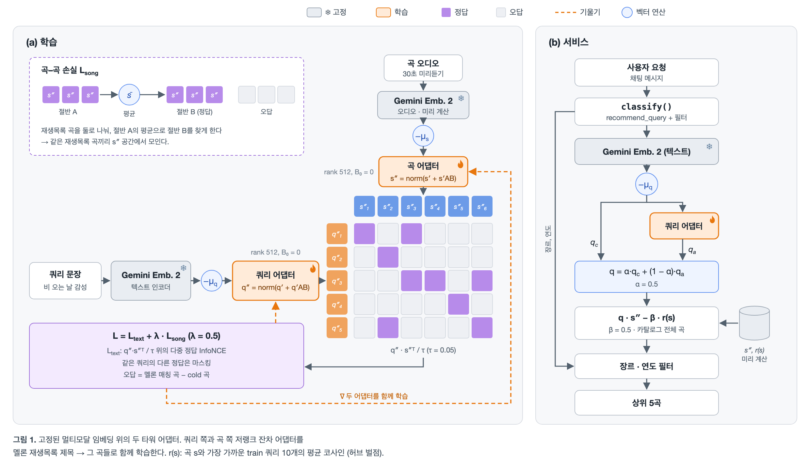
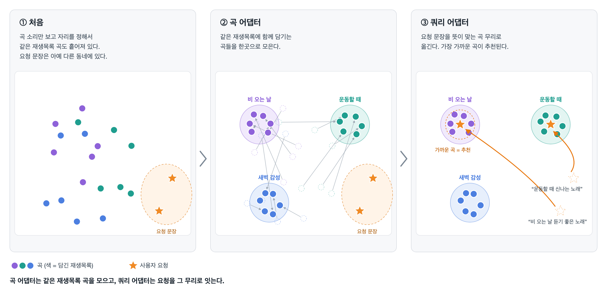

# 음악 추천 임베딩 어댑터

자연어 요청으로 음악을 추천하는 팀 프로젝트 서비스에서, **임베딩 모델을 다시 학습하지 않고 곡도 다시 임베딩하지 않은 채** 그 뒤에 붙인 작은 변환만 학습해 추천의 쏠림과 정확도를 고친 실험이다.

- 정답이 없는 문제를 멜론 플레이리스트로 **평가 가능하게 만들고** (정답, 누수 없는 분할, 실패별 지표)
- 학습 없는 **평균 제거**로 언어 편향·허브를 없앤 뒤, 그 위에 **저랭크 잔차 어댑터**(쿼리 쪽 + 곡 쪽)를 학습했다
- 모든 선택 규칙은 **결과를 보기 전에 고정**했고, test는 한 번만 열었고, 마지막에 **사람 블라인드 평가**로 확인했다

| | 원래 (지금 서비스) | 최종 (평균 제거 + 쿼리·곡 어댑터) |
| --- | --- | --- |
| test Recall@10 (멜론 정답, 1,968개 요청) | 0.0054 | **0.0547** |
| 서로 다른 두 요청의 top-10이 공유하는 곡 수 | 0.246곡 | **0.040곡** |
| top-10 중 K-pop 비율 (사람이 고른 정답은 49.5%) | 79.3% | **48.4%** |
| 사람 평가: 최종 vs 원래 (팀원 5명 × 요청 15개, 블라인드) | | **44승 10무 21패** (p = 0.006) |

추가 비용: 학습·서비스 반영 모두 API 재호출 0 (변환은 로컬 행렬 곱). 서비스 DB의 원래 벡터 칸은 그대로 둔다 → 되돌릴 수 있다.



---

## (1) 문제

1. **언어 편향**: 한국어 요청을 넣으면 top-10의 79.3%가 K-pop이다. 사람이 같은 요청(플레이리스트 제목)에 고른 곡은 49.5%만 K-pop이다. 한국어 문장끼리 임베딩 공간에서 가깝게 놓여 해외 곡이 잘 추천되지 않는다.
2. **허브**: 곡 몇 개가 모든 요청에 반복해서 추천된다. top-10 자리의 53%를 가장 자주 나온 상위 1% 곡(약 190곡)이 차지했다 (Radovanović et al., *Hubs in Space*, 2010).
3. **단어 매칭 (의심)**: "비 오는 날" top-10 중 7곡이 제목에 비/Rain이 든 곡이었다.
4. **개선 방법도, 확인 방법도 없음**: 임베딩 모델(Gemini Embedding 2, 3072차원)은 바꾸거나 다시 학습하기 어렵고(비용, DB 재구축), 무엇보다 "이 요청에 이 곡이 맞다"는 정답이 없어서 개선했는지 확인할 수 없었다.

## (2) 정답 만들기: 멜론 플레이리스트 → 학습·평가 데이터

[Melon Playlist Dataset](https://github.com/kakao/recoteam/discussions/9#discussioncomment-19119782) (Kakao Arena)의 플레이리스트를 "요청(제목) → 정답(수록곡)"으로 쓴다. 데이터는 재배포하지 않는다.

| 단계 | 하는 일 | 코드 |
| --- | --- | --- |
| 곡 매칭 | 멜론 곡 ↔ 서비스 DB 곡. 제목·첫 아티스트를 정규화해 정확 매칭. 버전 표기(Remix, Live …)는 다른 소리라 제외, "에픽하이 (EPIK HIGH)" 같은 한/영 표기와 "으르렁 (Growl)" 같은 번역 제목 별칭 처리 | [dataset/2_match_melon.py](dataset/2_match_melon.py), [match_rules.py](dataset/match_rules.py) |
| 비인기곡 추가 | 정답의 95%가 멜론 인기 상위 10% → 멜론 인기 10~50%·하위 50% 곡 3,925곡을 iTunes에서 찾아 추가 임베딩 (Batch API, 약 $9.5) | [dataset/3_tail_songs/](dataset/3_tail_songs/) |
| 분할 | **정규화한 제목의 해시**로 train/val/test 8:1:1 → 같은 제목이 train과 test에 동시에 들어가지 않는다 | [dataset/4_build_dataset.py](dataset/4_build_dataset.py) |
| 근접 중복 제거 | 정답이 80% 이상 겹치는 플레이리스트는 하나만 (제거 전에는 test의 23%가 train 플레이리스트와 거의 같았다) | 〃, [overlap.py](dataset/overlap.py) |
| cold 곡 | 정답 곡의 15%(1,291곡)를 학습 정답·오답 어디에도 쓰지 않는다 → "외운 곡만 맞히나"를 따로 잰다 | 〃 |
| 서비스 형식 검색어 | 플레이리스트 제목을 **서비스의 의도 분류 LLM(`classify()`)에 사용자 메시지처럼 그대로 넣어** 서비스가 실제로 임베딩하는 문장(`recommend_query`)으로 바꾼다. 장르·연도는 서비스처럼 필터로 빠진다. 추천 분기(74%)만 쓴다 | [dataset/5_service_queries.py](dataset/5_service_queries.py), [6_service_dataset.py](dataset/6_service_dataset.py) |

| 플레이리스트 제목 | 분기 | 임베딩하는 문장 |
| --- | --- | --- |
| 데이트 하기 전 들으면 설레는 노래 | 추천 | 데이트하기 전에 듣기 좋은 설레고 로맨틱한 노래 |
| 랩과 보컬의 케미2 (외국힙합) | 추천 (장르 필터 Hip-Hop/Rap) | 랩과 보컬이 조화를 이루는 외국 힙합 노래 |
| 점심먹고 기분전환 해야지! | 대화 이탈 | (임베딩 안 함) |

결과: 카탈로그 19,027곡 (서비스 15,102 + 비인기곡 3,925), 요청 train 17,802 / val 2,258 / test 1,968. val은 설정을 고르는 데, test는 마지막에 한 번만 쓴다.

**제한점**: 정답이 인기곡 위주다 (매칭 곡의 57%가 멜론 인기 상위 10%) → 모든 오프라인 지표는 "인기곡 범위 안에서"만 유효하다. 요청이 플레이리스트 제목이라 실제 사용자 말투와 다르다 → 사용자 말투 요청으로 따로 확인했다 (5-1, (7)). 멜론 데이터셋에는 2020년 이후 곡이 없다.

## (3) 평가 설계

정답이 대리(멜론 플레이리스트)라서 Recall 하나만 보면 **정답 데이터의 습관을 외운 시스템**을 고르게 된다. 그래서 막고 싶은 실패마다 지표를 하나씩 둔다. 모든 비교 스크립트가 같은 묶음을 낸다 ([core/metrics.py](core/metrics.py) `evaluate_all`).

| 막고 싶은 실패 | 지표 |
| --- | --- |
| 정답을 못 찾음 / 첫 정답이 너무 아래 | Recall@10, MRR |
| 학습한 곡만 외움 | cold Recall@10 (cold 곡만 정답, 같은 요청의 warm 정답은 순위에서 뺀다) |
| 언어 편향 | top-10 K-pop 비율 — **낮을수록 좋은 게 아니라 정답의 비율(49.5%)에 가까울수록 좋다** |
| 모두에게 같은 곡 (허브) | 검색어 간 겹침 (두 요청의 top-10이 공유하는 평균 곡 수), 허브 상위 1% 점유 |
| 같이 듣는 곡이 흩어져 있음 | 재생목록 응집도 (정답 절반의 평균 방향으로 나머지 절반을 찾는 R@10, 텍스트 없이 곡끼리만) |
| 범용 음악 검색 능력 훼손 | SDD R@10 (Song Describer Dataset: 영어 캡션 → 곡. 학습과 무관한 곡이라 곡 어댑터에게는 전부 처음 보는 곡) |

**판정 원칙**
- 실험마다 **그 실험이 풀려던 문제의 지표**로 판정하고, 기준은 **결과를 보기 전에** 정한다. 각 실험 파일 머리말에 적어 두었다.
- 정확도와 쏠림을 맞바꾸는 손잡이(α, β)는 한 규칙으로 고른다: **"검색어 간 겹침이 평균 제거 이하인 조합 중 val R@10 최대"** ([core/selection.py](core/selection.py)).
- 비교는 같은 요청 묶음의 **paired bootstrap 95% 구간**. 하한 > 0이면 개선, 0을 포함하면 구분 불가.
- **test는 한 번만 연다.** val로 여러 번 고르면 val의 우연한 변동까지 같이 고르게 된다 (실제로 초기 실험에서 val의 cold 개선이 test에서 재현되지 않았다).

## (4) 방법

$q$ = 요청 문장 임베딩, $s$ = 곡 오디오 임베딩 (둘 다 Gemini Embedding 2, 고정).

$$
\begin{aligned}
&q_c = \mathrm{norm}(q - \mu_q), \quad s' = \mathrm{norm}(s - \mu_s) && \text{평균 제거 (학습 없음)} \\
&q_a = \mathrm{norm}(q_c + q_c A_q B_q), \quad s'' = \mathrm{norm}(s' + s' A_s B_s) && \text{저랭크 잔차 어댑터 (rank 512, } B = 0\text{에서 시작)} \\
&\mathrm{score}(q, s) = \mathrm{norm}(\alpha q_c + (1 - \alpha) q_a) \cdot s'' - \beta \cdot r(s) && \text{α 혼합 + 허브 벌점}
\end{aligned}
$$

- **평균 제거**: 텍스트 임베딩끼리, 오디오 임베딩끼리 공유하는 공통 성분을 뺀다 (modality gap, Liang et al., 2022). $\mu_q$는 train 요청, $\mu_s$는 카탈로그로만 계산한다. → [core/systems.py](core/systems.py)
- **어댑터**: 임베딩은 그대로 두고 수정량 $AB$만 학습한다 (LoRA와 같은 형태). $B = 0$이라 처음엔 아무 변환도 하지 않는다. → [core/adapters.py](core/adapters.py)
- **손실**: multi-positive InfoNCE (τ = 0.05). 플레이리스트에는 정답이 여러 개라, 정답마다 "그 정답 + 오답들" 중에서 고르는 문제를 따로 낸다 (다른 정답끼리 밀어내지 않게). **오답 후보 = 멜론 매칭 곡 − cold 곡**: 멜론에 없는 곡은 라벨이 없을 뿐 오답이 아니다. 처음에 카탈로그 전체를 오답으로 썼더니 "멜론에 있는 곡인가"를 배우는 지름길이 생겼다 (R@10은 13배, SDD는 35.92 → 21.85로 붕괴).
- **곡 어댑터와 곡-곡 손실**: 쿼리 어댑터는 곡끼리의 거리를 못 바꾼다. 같은 재생목록 곡들이 흩어져 있으면(응집도 0.01) 요청 하나로는 다 모을 수 없다 → 곡 쪽에도 어댑터를 붙여 같이 학습하고, 같은 플레이리스트 곡끼리 모이게 하는 손실을 더한다: $\mathcal{L} = \mathcal{L}_\text{text} + \lambda \mathcal{L}_\text{song}$, λ = 0.5. 곡 쪽은 정규화가 있어 쿼리 쪽으로 접히지 않는다. → [train/train_two_tower.py](train/train_two_tower.py)
- **허브 벌점** $r(s)$ = 곡 $s$와 가장 가까운 train 요청 10개의 평균 코사인 (CSLS, Conneau et al., 2018). 라벨을 쓰지 않는다.
- 학습: AdamW lr 1e-3, batch 256, **5에폭 고정·마지막 시점** (val cold R@50 조기 종료는 평가마다 ±0.004 흔들려 잡음 중 최고를 고르게 됐다).



## (5) 실험

모두 서비스 형식 검색어 val로 판정했다. 결과 파일은 이 저장소의 코드로 다시 낸 보고서다.

| 절 | 질문 | 판정 기준 (사전 고정) | 결론 | 코드 · 결과 |
| --- | --- | --- | --- | --- |
| 5-1 | 학습 없이 평균만 빼면 쏠림이 줄어드나 | 겹침·허브 상위 1%가 val과 사용자 말투 요청 87개 **둘 다**에서 낮아지면 채택 | **채택.** 겹침 0.235 → 0.040, K-pop 78.9% → 45.1%. R@10 이득은 없음 → 정확도가 아니라 **쏠림 해소** 장치 | [코드](studies/5_1_mean_removal.py) · [결과](results/studies/5_1_mean_removal.md) |
| 5-5 | 허브 벌점 β와 혼합 α를 어떻게 고르나 | 겹침 ≤ 평균 제거 중 R@10 최대 | α = 0.25, β = 0.5. β는 α와 달리 **같은 겹침에서 R@10을 올린** 첫 방법 | [코드](studies/5_5_alpha_beta_grid.py) · [결과](results/studies/5_5_alpha_beta_grid.md) |
| 5-6 | 어댑터 rank는 얼마나 | 이웃 rank끼리 R@10 하한 > 0이면 큰 rank | **512.** 32→128 +0.0052, 128→512 +0.0019 [+0.0001, +0.0035], 512→3072 0 | [코드](studies/5_6_rank.py) · [결과](results/studies/5_6_rank.md) |
| 5-7 | 비인기곡 라벨을 정답 전용으로 쓰면 나을까 | 비인기곡 R@10 하한 > 0, R@10 손해 없음 | 다른 곡과 똑같이 쓴다. 곡당 정답이 약 6번(기존 곡 43번)이라 어떻게 써도 못 배운다 → **추가 구매 중단** | [코드](studies/5_7_tail_labels.py) · [결과](results/studies/5_7_tail_labels.md) |
| 5-8 | 학습 검색어 형식이 중요한가 | 서술 | 서비스 형식으로 학습한 쪽이 R@10 +0.0042 [+0.0010, +0.0074] (test에서도 +0.0044) | [코드](studies/5_8_query_format.py) · [결과](results/studies/5_8_query_format.md) |
| 5-9 | 곡 어댑터를 같이 학습하면 나을까 | 처음 설계(곡-곡 손실 없음, λ0) − 쿼리 어댑터 R@10 하한 > 0 | λ0은 **손해**(−0.0051): 곡 어댑터가 "같이 듣는 곡 모으기"가 아니라 "인기곡 끌어내기"를 배운다. **곡-곡 손실 λ0.5는 +0.0102**, 응집도 0.0097 → 0.134 | [코드](studies/5_9a_two_tower.py) · [결과](results/studies/5_9a_two_tower.md) |

멜론 원문 형식 검색어("제목 | 태그") 시절에 한 실험(α 혼합, 인기도 보정 logQ, 학습률·조기 종료가 모두 "어댑터가 원래 공간에서 얼마나 멀어지나"라는 같은 손잡이였다는 결론 등)은 이 저장소에 옮기지 않았다.

## (6) 결과

test (서비스 형식 요청 1,968개, 설정 선택에 한 번도 쓰지 않은 데이터, 한 번만 평가). 무작위로 줄 세우면 R@10 ≈ 0.0005다.

| test | R@10 | MRR | cold R@10 | 검색어 간 겹침 | 허브 상위 1% | top-10 K-pop | 응집도 warm |
| --- | --- | --- | --- | --- | --- | --- | --- |
| 원래 임베딩 (지금 서비스) | 0.0054 | 0.0153 | 0.0026 | 0.246 | 53.0% | 79.3% | 0.0070 |
| 평균 제거 | 0.0053 | 0.0176 | 0.0024 | 0.041 | 21.3% | 44.8% | 0.0088 |
| 평균 제거 + 쿼리 어댑터 (r512, α0.25 β0.5) | 0.0470 | 0.1184 | 0.0063 | 0.040 | 20.6% | 50.1% | 0.0088 |
| **평균 제거 + 쿼리·곡 어댑터 (λ0.5, α0.5 β0.5)** | **0.0547** | **0.1257** | 0.0056 | 0.040 | 21.4% | 48.4% | **0.1393** |

(정답 곡 K-pop 비율 49.5%) · 원본: [results/final_test.md](results/final_test.md) · 코드: [studies/6_final_test.py](studies/6_final_test.py)

- 주 비교(사전 고정): 쿼리·곡 어댑터 − 쿼리 어댑터 R@10 **+0.0078 [+0.0036, +0.0121]** → 최종 후보. cold는 구분 불가
- 쿼리 어댑터 − 평균 제거: R@10 +0.0416 [+0.0361, +0.0475]
- 평균 제거 − 원래: R@10 차이 없음, 겹침 0.246 → 0.041, K-pop 79.3% → 44.8%

**해석**
- 평균 제거는 쏠림(언어 편향, 허브)을 없애고, 어댑터는 그 쏠림을 다시 만들지 않으면서 정확도를 올린다.
- 이득은 전부 **함께 들은 기록이 있는 곡**에서 나온다. 처음 보는 곡(cold)은 쿼리 쪽, 곡 쪽, 두 타워 어떤 방법으로도 나아지지 않았다.
- 정답이 멜론 플레이리스트라 "멜론 사용자가 같이 넣는 곡 조합"을 잘 맞힌 것이다 → 사람에게도 나은지는 (7)에서 확인했다.

### (6-1) 사후 확인: 처음 보는 곡에 대한 안전성

test를 연 뒤 SDD 회귀 테스트([studies/6_sdd.py](studies/6_sdd.py))에서 쿼리·곡 어댑터가 원래 공간보다 **−4.56 [−7.91, −1.21]** 나빠진 것을 발견했다. SDD 곡은 학습에 한 번도 안 나온 곡이라, 곡 어댑터가 처음 보는 곡의 배치를 흐트러뜨린다는 뜻이다.

곡 쪽에 평균 제거 곡을 섞는 $s_\text{mix} = \mathrm{norm}(\gamma s' + (1 - \gamma) s'')$를 재학습 없이 시험했다 ([studies/5_9b_song_side_mix.py](studies/5_9b_song_side_mix.py), 규칙은 결과 보기 전에 고정: SDD가 원래보다 유의하게 낮지 않은 γ 중 val R@10 최대).

| | test R@10 | SDD valid R@10 (원래 35.92) |
| --- | --- | --- |
| 쿼리·곡 어댑터 (γ = 0, 곡 어댑터 100%) | **0.0547** | 31.37 (유의하게 낮음) |
| 쿼리·곡 어댑터 (γ = 0.25, 곡 어댑터 75%) | 0.0469 (쿼리 어댑터와 구분 불가) | **36.19** (원래와 구분 불가) |

γ = 0.25는 정확도를 일부 내주고 처음 보는 곡을 지키는 보완안이다. 다만 **test를 연 뒤에 고른 것이고, 사람 평가는 γ = 0으로 했다.**

**출시 결정: γ = 0.** 실험(사전 고정한 test 주 비교, 사람 평가)은 γ = 0으로 진행했다. 결과를 본 뒤 기준을 바꿔 검증하지 않은 버전을 내보내지 않는다. γ = 0.25는 새로 들어오는 곡이 많아질 때를 위한 다음 실험으로 남긴다. 원본: [results/final_test_posthoc.md](results/final_test_posthoc.md)

## (7) 사람 평가

- 요청마다 추천 목록 3개(원래 / 평균 제거 / 쿼리·곡 어댑터) × 5곡을 **블라인드**로 보여주고 1·2·3등을 매긴다 (같은 등수 허용, 목록 배치는 요청마다 섞는다)
- 목록은 서비스 검색과 같은 규칙: 장르·연도 필터, 5곡이 안 되면 장르를 풀어 채우기, 중복 제거 ([human_eval/export_lists.py](human_eval/export_lists.py))
- 요청: 실제 사용자 말투 15개 (상황·기분 / 장르·연도 / 곡 수 지정 / 음악 외 요청 섞임 / 조합), 실험자를 뺀 팀원 5명 → 판정 75개
- **채택 규칙 (결과를 다 보기 전 확정)**: "분명히 이김" = 부호 검정 p < 0.05 이고 같은 쪽을 고른 사람이 3명 이상. 원래가 평균 제거를 분명히 이기면 배포 없음 → 원래나 평균 제거가 쿼리·곡 어댑터를 분명히 이기면 평균 제거만 → 그 밖에는 쿼리·곡 어댑터
- 5명으로는 작은 차이를 가려낼 수 없으므로 "사람이 분명하게 거부하는 것을 막는" 안전장치로 쓴다

| 비교 | 승 | 무 | 패 | 부호 검정 p | 사람별 |
| --- | --- | --- | --- | --- | --- |
| 쿼리·곡 어댑터 vs 원래 | 44 | 10 | 21 | 0.006 | 4명 : 1명 |
| 쿼리·곡 어댑터 vs 평균 제거 | 45 | 8 | 22 | 0.007 | 5명 : 0명 |
| 평균 제거 vs 원래 | 36 | 6 | 33 | 0.810 | 3명 : 2명 |

판정: **쿼리·곡 어댑터 배포** (분명히 진 비교 없음). 오히려 둘 다 분명히 이겼다. 원본: [results/human_eval.md](results/human_eval.md) · 코드: [human_eval/tally.py](human_eval/tally.py)

## 한계와 다음

- 처음 보는 곡(cold)은 어떤 방법으로도 나아지지 않았다. 이득은 함께 들은 기록이 있는 곡에서만 나온다 → 실제 사용 기록이 쌓이면 정답으로 쓴다
- λ는 0, 0.25, 0.5, 1만 시험했다. 오프라인 Recall에는 아직 장르·연도 필터를 적용하지 않았다
- 서비스 반영: μ_q, μ_s, 어댑터 가중치, α, β를 한 묶음 상수로. 곡마다 $[s'', -\beta r(s)]$를 DB 새 칸에 미리 계산하고, 요청은 임베딩 직후 변환한다. 원래 칸은 남겨 되돌릴 수 있게 한다

---

## 코드 구조

```
config.py             경로(환경 변수), 이름표(뜻 있는 이름 → 원래 실험 파일명), 격자·최종 설정
core/
  data.py             카탈로그·검색어 벡터·정답 불러오기 → Bench
  systems.py          평균 제거 · α 혼합 · 곡 쪽 섞기 · 허브 벌점 = 시스템 하나 (AdapterSystem.space(α, β, γ))
  adapters.py         LowRankAdapter, multi_positive_infonce, 체크포인트 불러오기
  metrics.py          지표 묶음 evaluate_all, paired bootstrap, 응집도
  sdd.py              SDD 회귀 테스트 채점
  evaluator.py        시스템을 이름으로 정의(Spec)하고 같은 묶음으로 채점
  selection.py        α × β 격자와 선택 규칙
  report.py           표·구간을 출력하면서 runs/에 보고서로 남긴다
  safe_io.py          쓰기는 runs/에만, 원본 SQLite는 읽기 전용, 유료·DB 쓰기 전 확인
dataset/  1~7         (2) 정답 만들기 (위 표)
train/                (4) 쿼리 어댑터, 두 타워 학습
studies/              (5)·(6) 실험. 파일마다 머리말에 질문 / 입력 / 출력 / 판정 기준 / 결과
human_eval/           (7) 목록 만들기, 평가 서버·페이지, 집계
results/              게시용 결과 (아래 실행으로 다시 만들 수 있는 보고서 + 원래 test 결과)
```

모든 스크립트는 `python -m <폴더>.<파일>`로 실행하고, 결과는 실행마다 새 폴더 `runs/{날짜}_{이름}/`에 쓴다. 원래 실험 데이터(`EMB_DATA_DIR`)는 읽기만 한다.

```bash
pip install -r requirements.txt
export EMB_DATA_DIR=<카탈로그·데이터셋·체크포인트 폴더>  SDD_DIR=<SDD 폴더>  MELON_DIR=<멜론 데이터셋>
python -m studies.5_1_mean_removal          # 각 실험 (val)
python -m train.train_query_adapter --tag r512
```

**재현성**: 이 저장소는 원래 실험 코드를 정리한 것이다. 정리한 코드로 다시 낸 결과가 원래 실험 로그의 수치(실험 9개, 학습 로그 에폭별 손실)와 끝자리까지, 데이터 준비 산출물(매칭·데이터셋·사람 평가 목록)과는 파일 md5까지 모두 같은 것을 확인했다. 외부 API·팀 DB가 필요한 단계(검색어 변환, 임베딩, 카탈로그 추출, iTunes 검색)는 실행하지 않고 코드로 기록했다 — 실행 전에 호출 수·비용을 보여주고 확인을 받는다. 원래 파일 → 새 파일 대응과 확인 내역: [docs/refactor_notes.md](docs/refactor_notes.md)
